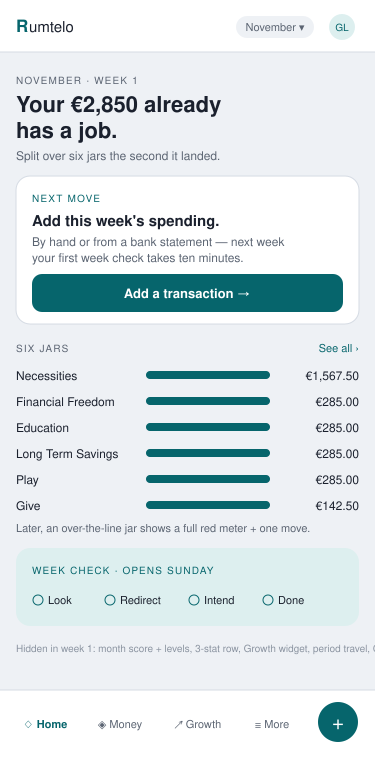
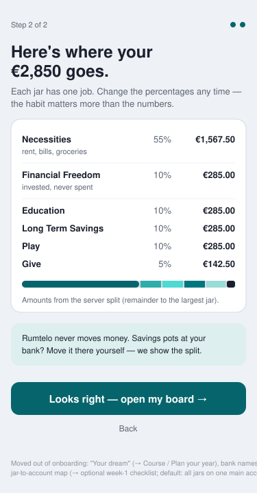
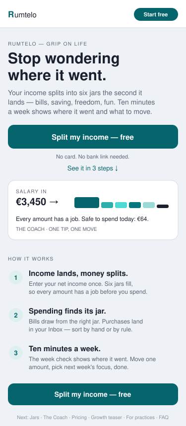

# Clarity audit: what Rumtelo does, said once and shown first

> **Note (2026-11-23):** This document was written when every household had six jars. A new household now starts with three pots (Basics 55 · Future 20 · Free 25) and refines them; existing households keep six. Read "six jars" below as "the household's pots" and the six-name lists as the old names. Current model: [split-system-proposal.md](./split-system-proposal.md).

**Date:** 2026-11-16 · **Method:** `.claude/skills/product-audit` (product-manager, ux-ui-designer and brand-copywriter in parallel; the orchestrator merged and spot-checked) · **Status:** proposal, nothing built.

**Problem (Given):** *"It's still very unclear to customers what Rumtelo does and how it can help them. There's too much going on."*

**Short answer:** the product already has one strong, concrete story: **income splits into six jars the second it lands, and ten minutes a week keeps it that way.** The website, the onboarding and Home all hide that story behind a wider one ("all of it — money, life, energy, time"), four portals, two systems of levels and locks, and about 38 named concepts in week 1. The fix is subtraction, not new features. Lead with the jars, let the first screen prove them with the user's own euros, give each screen one next move, and let the rest of the board appear once the user has a reason to need it.

**Evidence base.** Staging website `https://dev.rumtelo.com` was read in the browser (desktop and 375 px, public pages only, no sign-in). Everything else comes from the code and the EN/NL i18n source. Not verified: the rendered app screens (Home, onboarding, Course) at 375 and 1280 px. Those findings come from components and copy, so check them on staging.

**Contents:** [1 Answers](#1-the-five-questions-answered) · [2 Findings](#2-findings-ranked-by-impact) · [3 Positioning](#3-positioning) · [4 Information architecture](#4-simplified-information-architecture) · [5 Website](#5-website-changes) · [6 Onboarding and Home](#6-onboarding-and-home-changes) · [7 Mockups](#7-mockups) · [8 Backlog](#8-implementation-backlog) · [9 Open decisions](#9-open-decisions-for-given)

---

## 1. The five questions, answered

### What does a new visitor understand in the first 30 seconds?

| Visitor (`audience.md`) | What is this? | Is it for me? | What do I do now? |
| --- | --- | --- | --- |
| Doing well | **Failed.** "Stop wondering where it went" plus "all of it: your money, your life, your energy, your time" reads like a life-coaching app. | Partly. The audience line only appears far down the page. | "Start free". Clear. |
| Wants change | **Failed.** The mechanism (six jars) appears only in a proof chip and an animated demo. On a phone, the first screen has no product picture. | Yes: the "no shame" tone lands. | Start free, then two onboarding flows before any result. |
| Wants success, lacks a map | **Failed.** Nothing promises a map. Course, the planner, is never named on the website. | Unclear. | Start free, then an unclear first week. |
| Practice (coach/advisor) | Clear, but only in the pricing tab: *"Stop wondering where your clients stand."* | Yes, once found. | "Start a practice". It sells MANAGE, which is read-only today (backlog #1). |

The clearest explanation of the product sits **behind** sign-up, in onboarding: *"We split income into six jars so you always know what is for bills, saving, and living."* (`pages.onboarding.welcome_body`). The sign-up subtitle *"Six jars. One calm overview."* is the line the hero needs.

### What is the one promise and the one first step?

- **Today:** the promise is grip on money, life, energy and time, but production ships only Money and Growth. Competing primary actions: Home has about 20 tappable targets and 3 competing primaries (the Coach tip CTA, Close month, and the Quick-add button with 9 kinds). Onboarding ends on a full board plus a tour offer.
- **Proposed promise:** **every euro gets a job the second it lands; ten minutes a week keeps it that way.**
- **Proposed first step:** *enter your net income and see it split into six jars, in euros.* After that, Home always shows **one** next move: add spending → sort the Inbox → do the week check → close the month.

### How many concepts and menu items hit a new user in week 1?

- **Concepts: about 38** (full list in [appendix A](#appendix-a-concepts-met-in-week-1)). Week 1 needs **7**: household, six jars, income split, fixed costs, Inbox, week check, The Coach.
- **Navigation destinations: 16 in production** (3 portal pills + 13 sub-items; 4 of them locked on Basic) and **29 on staging** (Soul alone has 6). Add a 6-item user menu, 15 settings tabs and a Quick-add with 9 kinds. On mobile the portal list appears twice: in the header dropdown and in the bottom tabs.
- **Landing page: 9 sections**, and four products are explained before the core mechanism (Hero → Portals → Jars …).

### Where does the user drop off or get confused?

1. **Hero → scroll.** The mystery line and the "all of it" decode give no mechanism. A visitor who doesn't scroll leaves without knowing what the product does.
2. **Onboarding steps 3–6.** The user sees percentages, not their euros. "Your dream" comes before any value. A second flow asks for bank names, IBAN and a jar-to-account map before the board is shown. There is no "your money now has jobs" moment.
3. **Home, day 1.** A month score with levels (Beginner → Compass) and a Close-month button appear before a single week exists. The empty state says *"All sorted — time for intention."*, praise for doing nothing that also points to a Soul concept.
4. **The week check is missing from the navigation.** The product's core habit (principle 2) is reachable only from a Coach CTA after the Inbox is empty, and that CTA disappears when the Coach is turned off. Course has a **second** "week check".
5. **Locks.** A locked page shows 🔒, "Available in the {plan} plan" and an upgrade button. It shows no price (computed but not rendered), no outcome, no preview and no way back.
6. **Promises the product doesn't keep in production:** sleep, stillness and intention in the hero floaters, ticker and demo Coach line; "Energy carries money" as a principle; Plus listing "ENERGY · your 168 hours"; Practice promising "energy, stillness" snapshots; the onboarding dream "on your dashboard", which shows only in the Soul widget that production hides; the Coach's quiet state linking to `/product/energy/week`.

### What can be hidden, merged, deferred or progressively unlocked?

| Action | What |
| --- | --- |
| **Hide in production** | Everything Energy/Soul on the website and in the app (floaters, ticker, demo line, principle 3 on the landing, Plus/Practice lines, Home help text, Coach link). Keep principle 3 in docs and on Why. |
| **Merge** | Money goals into Course › Goals (already decided; branch `claude/course-goals-backend`). The two week checks into one flow with Money stages first. Income into Money (it drives the split). Net worth into one place. "Transactions" and "Inbox" into one name: **Inbox**. |
| **Defer (show after a trigger)** | Month score and levels (after the first week check, or in the last 7 days of the period), Debt, Net worth, Learn, Course for Plus (after the first week check), the household name, the dream, and bank/IBAN mapping (week-1 checklist). |
| **Move out of the household path** | Practice: its own website page; "Start a practice" only in Settings, not in the avatar menu and not as an onboarding escape. |
| **Progressively unlock** | Yes: Money is the door, and the rest appears through events, not dates (section 4). Plan capability still decides *what exists*; the ladder only decides *when it appears*. A "Show everything now" switch keeps it from becoming a cage. |

---

## 2. Findings, ranked by impact

| # | Area | Finding | Evidence | Severity |
| --- | --- | --- | --- | --- |
| 1 | Website hero | The H1 is a deliberate mystery and the sub widens it ("all of it — money, life, energy, time"). Jars, the split and ten minutes a week appear only in the proof strip and the demo. The landing nav "How it works" links to the jar rules (`#jars`); there is no how-it-works section. | `pages.landing.hero.lead`, `proof.*`, `header.how_it_works`; staging | High |
| 2 | Website ↔ product | The website sells features that production hides: hero floaters/ticker (sleep 7h20, stillness, intention), a demo Coach line about sleep, principle "Energy carries money", Plus "ENERGY · your 168 hours", Practice "energy, stillness". `FLOATERS` and `TICKER` are not launch-filtered (pricing and FAQ are). | `landing-hero.tsx:126,148`; `landing.ts floaters.*`, `ticker.*`, `plans.plus.*`, `practice_plan.f3` | High |
| 3 | Onboarding | 6 screens, about 10 decisions, no value moment. The jars step shows %, not €. Bank/IBAN/jar-map bookkeeping comes before the board. The income copy says "Next you will name the bank account", but the next screen is the jars. | `onboarding-flow.tsx`, `jar-bank-setup-flow.tsx`, `jars-step.tsx:59`, `pages/onboarding.ts` | High |
| 4 | Home | No first-run variant. About 20 targets, 3 competing primaries. Month score and levels show on day 1. The empty state is "All sorted — time for intention." | `home-dashboard.tsx:415-612`, `quick-add.tsx`, `dashboard.coach.all_sorted` | High |
| 5 | Core habit | The Money week check is in no menu, and its only entry disappears when the Coach is off. A second flow, the Course week check, has the same name. | `nav.ts`; `home-dashboard.tsx:308-319`; `product/money/week-check`, `product/growth/course/week-check` | High |
| 6 | NL copy | The generated NL has errors that change the meaning on the landing page and Home. Hero eyebrow: "HET LEVEN IN DE GREEP" ("life has you in its grip"). Proof label: "de gronden die extra inkomsten opleverden…" (nonsense). Jars eyebrow: "DE ZES KRUIKEN" (jugs). Principle: "Energie levert geld op" ("energy earns money"). Practice CTA: "Uitnodiging voor een recensie" ("an invitation to write a review"). The approved twins in `quotes.md` are not pinned in `overrides.ts`. | `languages/nl.json` (orchestrator spot-checked these five) | High |
| 7 | Broken promise | The dream from onboarding ("We put it on your dashboard") is shown only in the Soul widget, which production hides. | `onboarding.ts why_body`; `home-dashboard.tsx:584-596` | High |
| 8 | Concept load | About 38 named concepts in week 1, with 7 needed (appendix A). | all three reports | High |
| 9 | Fake unlocks | Month-score levels claim unlocks ("Coach", "Goals", "Debts", "Energy layer" at levels 3–5), but nothing gates on them: Coach and Goals are open on day 1, and Debt is gated by plan. This contradicts the plan locks. | `month-score.service.ts:27-37`, `dashboard.levels.unlocks` | Medium |
| 10 | Locks | No price, no outcome, no preview, no "Not now". Nav locks are a faded 🔒 that is hidden from screen readers. Basic sees 4 of 13 production sub-items locked. | `locked-gate.tsx`, `_lib/plan.ts:110-128`, `household-shell.tsx:619-695` | Medium |
| 11 | IA duplicates | Income (Money loop) sits under Growth. Net worth sits under Money but uses a Growth capability plus a redirect route. Goals appear in 3 places. Jars, the core model, has no nav item. The nav says "Transactions" and The Coach says "Inbox". The Coach has 5 entry points. | `nav.ts`, `growth/net-worth/page.tsx`, `course-goals-view.tsx` | Medium |
| 12 | Course invisible | Course, the main reason to buy Plus, is never named on the website or on pricing. Plus is sold on debt, import and Learn. Pricing meters ("Money 3/6 features") frame Basic as a shortfall. | `landing.ts plans.*`, `landing-pricing.tsx:520-570` | Medium |
| 13 | Practice on the household path | Header link, pricing audience toggle, an onboarding escape ("Start a practice instead") and "Start a practice" in every owner's avatar menu. MANAGE is billed but read-only. | `landing.ts header.practices`, `onboarding.ts practice_escape`, `PracticeMenuLink offerStart` | Medium |
| 14 | Stale promises | "live sync coming" (Plus), "Devices … (coming)" (Max), "Coming next: editing their plan" (Practice; "plan" there is ambiguous). | `plans.plus.f3`, `plans.max.f6`, `practice_plan.extra_manage_hint` | Medium |
| 15 | Mobile shell | Portals listed twice (header dropdown + bottom tabs); Settings pill hidden below `sm`. | `household-shell.tsx` | Medium |
| 16 | Naming drift | EN "Why this practice matters." should use *routine*. NL mixes potten/potjes/kruiken, Noodzaak/Noodzakelijk, u/je, klanten/cliënten, "wekelijkse controle"/weekcheck. | `features/capabilities.ts:13`; `nl.json` | Low |
| 17 | Pricing lead | It describes the Stripe flow ("only when signup, verify and onboarding succeed"), not the value. | `pricing_section.lead` | Low |
| 18 | Book list | The landing page lists *The Secret*, which sits badly with "no soft abstraction". | `why.books.secret` | Low (Given's call) |

---

## 3. Positioning

**Brand key (unchanged):** **Stop wondering where it went.** / *Niet meer gissen waar het bleef.*

**Positioning line (new, directly under the key):**

| EN | NL |
| --- | --- |
| **Every euro gets a job the second it lands. Ten minutes a week keeps it that way.** | **Elke euro krijgt een taak zodra hij binnenkomt. Tien minuten per week houdt het zo.** |

Short form for chips, ads and the app-store subtitle: **Six jars. Ten minutes a week.** / *Zes potjes. Tien minuten per week.*

**Explanation (one paragraph):** Rumtelo gives every amount a job before you spend it. When your income lands, it splits at once into six jars: Necessities, Financial Freedom, Education, Long Term Savings, Play and Give. Your bills draw from the right jar, and your spending gets sorted into its jar, either by a rule or by hand. Once a week, a ten-minute week check shows where it went and lets you move what is left. The Coach gives one tip with one next move, and you choose. Rumtelo never moves your money: you stay in charge at your own bank. Start with your money, then grow from there with goals and your Course.

**Why this line.** It names the mechanism (split on arrival), the effort (ten minutes a week) and the result (no more wondering), using principles 1 and 2 word for word. It keeps the mystery key as the door, but decodes it into **the product** rather than into "all of it". The "money, life, energy, time" decode moves to the Why section and returns to the hero only when Energy and Soul ship. It fits every audience: people doing well want control without daily homework; people who want change get a first move with no shame; people without a map get a split today and a Course later.

---

## 4. Simplified information architecture

### Navigation before → after (production)

| Level | Before | After |
| --- | --- | --- |
| Portals (desktop pills, mobile bottom tabs) | Home · Money · Growth (staging: + Energy · Soul) | **Home · Money · Growth · More** |
| Home | Overview · The Coach · Why Rumtelo? | **no sub-nav.** One next-move card; the Coach page and Why move to More |
| Money | Overview (jars embedded) · Fixed costs · Transactions · Debt🔒 · Net worth🔒 | **Jars · Inbox · Fixed costs · Income**, plus a **Week check** button in the Money header |
| Growth | Overview · Course🔒 · Income · Goals · Learn🔒 | **Course (Today · Week · Goals)**: Growth opens on Course. Basic sees a Course preview (see decision D1) |
| More (sheet on mobile, menu on desktop) | none | Debt · Net worth · Learn · The Coach · Why Rumtelo · Settings · Help · Practice (only when linked) |
| Mobile | Header portal dropdown + 3 bottom tabs + subnav dropdown + FAB | **4 bottom tabs** + FAB; header dropdown removed |
| Quick add | 9 kinds + Ask | Week 1: **Transaction · Statement · Fixed cost · Income**; the rest after their unlock |
| Avatar menu | Language · Appearance · Practice / **Start a practice** · Settings · My plan · Sign out | Language · Appearance · My plan · Sign out (Practice link only when a practice exists) |
| **Destinations** | **16** (prod) / **29** (staging) | **12**, at most 4 per level |

At launch, Energy and Soul become portals 4 and 5 and More moves into the avatar menu. Until then they show in More as "Preview" on staging only.

### What a user sees: week 1 vs month 1

Triggers are events, not dates. They decide **when** something appears; plan capability still decides **whether** it exists.

| Stage | Trigger to enter | Visible | Principle |
| --- | --- | --- | --- |
| **Day 1** | Onboarding done (income split) | Home: promise + split in € + one next move. Money › Jars, Inbox. Quick add (4 kinds). | 1 Split first |
| **Week 1** | First 5 transactions sorted, **or** day 5 | + Fixed costs, Income, **Week check card** on Home (opens at the weekend). Week-1 checklist: name bank accounts, set your dream, invite your partner. | 1, 2 |
| **Weeks 2–4** | First week check done | + Course (Plus: "Set your 3"; Basic: preview and 1 goal), the Coach page, Goals. | 2 Ten minutes |
| **Month 1** | First month closed | + Month score on Home (levels after the first close), Debt, Net worth, Learn surfaced from More. | 4 Information, never shame: a score only once there is a month to score |
| **Later** | Opt-in | Energy and Soul once launched; Practice from Settings. | 3 Energy carries money |
| **Always** | | Home shows at most **one** Coach tip; the rest live on the Coach page. Settings › "Show everything now" skips the ladder. | |

Hidden is not removed: anything not yet surfaced stays reachable through More and search, and every locked or deferred item says what it adds.

---

## 5. Website changes

**Section order:** Hero → **How it works (new, 3 steps)** → The six jars → The Coach → Pricing (Course named on Plus) → Growth teaser ("Then grow: goals and your Course") → For practices (short band, link to its own page) → FAQ → Sign-up. Portals, Principles and Why fold into one "Grip on life" band after Pricing.

### Hero

| | EN | NL |
| --- | --- | --- |
| Eyebrow | RUMTELO — GRIP ON LIFE | RUMTELO — GRIP OP JE LEVEN |
| H1 | Stop wondering where it went. | Niet meer gissen waar het bleef. |
| Sub | Your income splits into six jars the second it lands — bills, saving, freedom, fun. Ten minutes a week shows where it went and what to move. | Je inkomen gaat zodra het binnenkomt over zes potjes — vaste lasten, sparen, vrijheid, plezier. Tien minuten per week laat zien waar het bleef en wat je verschuift. |
| Primary CTA | Split my income — free | Verdeel mijn inkomen — gratis |
| Microline | No card. No bank link needed. | Geen kaart. Geen bankkoppeling nodig. |
| Secondary | See it in 3 steps | Bekijk het in 3 stappen |
| Demo Coach line | Every amount has a job. Safe to spend today: €64. | Elk bedrag heeft een taak. Vandaag veilig uit te geven: €64. |

### How it works

| # | EN | NL |
| --- | --- | --- |
| 1 | **Income lands, money splits.** Enter your net income once. Rumtelo splits it over six jars, so every amount has a job before you spend. | **Inkomen binnen, geld verdeeld.** Vul één keer je netto-inkomen in. Rumtelo verdeelt het over zes potjes, zodat elk bedrag een taak heeft vóór je uitgeeft. |
| 2 | **Spending finds its jar.** Bills draw from the right jar. Purchases land in your Inbox; sort them by hand or let a rule do it. | **Uitgaven vinden hun potje.** Vaste lasten gaan van het juiste potje af. Aankopen komen in je Inbox; sorteer ze zelf of laat een regel het doen. |
| 3 | **Ten minutes a week.** The week check shows where it went and what's left. Move one amount, pick next week's focus, done. | **Tien minuten per week.** De weekcheck laat zien waar het bleef en wat er over is. Verschuif één bedrag, kies je focus voor volgende week, klaar. |

### Pricing and Practice

- **Pricing lead.** EN: *Start free with your jars. Pay when it saves you work: your bank statements in, your debt-free date, your Course.* NL: *Begin gratis met je potjes. Betaal pas als het je werk scheelt: je bankafschriften erin, je schuldenvrije datum, je Koers.*
- **Plus:** name **Course** as the main line. Remove "live sync coming". Replace the "Money 3/6 features" meters with outcomes.
- **Max:** remove "Devices … (coming)" until devices ship.
- **Practice door (own page `/practices`, short band on the landing).** EN: ***Stop wondering where your clients stand.*** *One desk for every client's jars and week check — only after they say yes. Rumtelo never moves money.* NL: ***Niet meer gissen waar je cliënten staan.*** *Eén bureau voor de potjes en weekcheck van elke cliënt — pas nadat zij ja zeggen. Rumtelo verplaatst nooit geld.*
- **Practice f3 (production).** EN: *A snapshot per client: income, jars, spending, week check.* NL: *Per cliënt een momentopname: inkomen, potjes, uitgaven, weekcheck.*

---

## 6. Onboarding and Home changes

### Onboarding: from 6 screens to 2 + a checklist

| Before | After |
| --- | --- |
| 1 Welcome (+ "Start a practice instead") | **1 Your income:** currency, net monthly income. Household name pre-filled ("{first name}'s household"), editable later. |
| 2 Income + household name | **2 Here's where it goes:** six jars with **your €**, then "Looks right — open my board". |
| 3 Jars (percentages) | → Home (week-1 layout) |
| 4 Your dream | → Course / "Plan your year" intake (decided direction), or the week-1 checklist |
| 5 Name bank accounts + IBAN | → Week-1 checklist, optional. Default: all jars on one main account |
| 6 Link jars to accounts | → Week-1 checklist, optional |

The € preview must come from the server split (`money.util.ts`, remainder to the largest share). That needs a small preview procedure; the client must not compute it.

**Split screen copy.**

| | EN | NL |
| --- | --- | --- |
| Title | Here's where your {amount} goes. | Hier gaat je {amount} naartoe. |
| Body | Each jar has one job. Change the percentages any time — the habit matters more than the numbers. | Elk potje heeft één taak. Pas de percentages aan wanneer je wilt — de gewoonte telt meer dan de getallen. |
| Jar line | Necessities · {amount} — rent, bills, groceries | Noodzakelijk · {amount} — huur, vaste lasten, boodschappen |
| Note | Rumtelo never moves money. Savings pots at your bank? Move it there yourself — we show the split. | Rumtelo verplaatst nooit geld. Spaarpotjes bij je bank? Zet het daar zelf over — wij laten de verdeling zien. |
| CTA | Looks right — open my board | Klopt — open mijn overzicht |

### Home: one next move, driven by state

| State | Next-move card (EN) | NL | CTA |
| --- | --- | --- | --- |
| No transactions | **Your jars are filled. Now see where it goes.** Add this week's spending — by hand or import a bank statement. Next week, your first week check takes ten minutes. | **Je potjes zijn gevuld. Kijk nu waar het heen gaat.** Voeg de uitgaven van deze week toe — zelf of importeer een bankafschrift. Volgende week duurt je eerste weekcheck tien minuten. | Add a transaction / Transactie toevoegen |
| Inbox has items | **{n} lines in your Inbox — about {m} minutes.** | **{n} regels in je Inbox — zo'n {m} minuten.** | Sort the Inbox / Inbox sorteren |
| Inbox clear, week check due | **Inbox clear. Your week check is ready — ten minutes.** | **Inbox leeg. Je weekcheck staat klaar — tien minuten.** | Start week check / Weekcheck starten |
| Month end | **Close {month}: see your score and carry what's left.** | **Sluit {month} af: zie je score en neem mee wat over is.** | Close month / Maand afsluiten |

### Locked feature (explain the gain)

| | EN | NL |
| --- | --- | --- |
| Title | {feature} is in {plan} · {price}/month | {feature} zit in {plan} · {price}/maand |
| Body | {gain}. Everything you've entered stays yours on every plan. | {gain}. Alles wat je invult blijft van jou, op elk abonnement. |
| Gain: Debt | See the date you're debt-free and what one extra payment changes. | Zie wanneer je schuldenvrij bent en wat één extra aflossing verandert. |
| Gain: Course | Plan your week around the three things that move your goals. | Zet je week rond de drie dingen die je doelen vooruit helpen. |
| Gain: Import | Bring in a bank statement instead of typing every amount. | Importeer een bankafschrift in plaats van elk bedrag in te typen. |
| Actions | Try {plan} · Not now | Probeer {plan} · Nu niet |

Prices come from `PLAN_RETAIL_CENTS`, never from copy.

---

## 7. Mockups

Static SVGs at phone width (375 px), using brand tokens. The copy follows sections 5 and 6.

| Home, week 1 | Onboarding: split your first income | Website hero + how it works |
| --- | --- | --- |
|  |  |  |

What each shows:

- **Home, week 1:**
  - the promise in the user's euros;
  - one next-move card with one primary button;
  - six jar meters;
  - the week check as a coming event;
  - 4 bottom tabs plus the FAB.

  The month score, the stat row, the Growth widget and the Coach slider are hidden until their trigger.
- **Onboarding split:** the user's income in € per jar, one reassurance ("never moves money"), one CTA. Dream and bank mapping move out.
- **Website hero:** the key, the mechanism in the sub, one CTA, a demo of the split, then three steps and the CTA again.

---

## 8. Implementation backlog

Priority per `CLAUDE.md`. Size and estimate are agent effort on the `CLAUDE.md` scale (S < 1 h, M 1–4 h, L 4 h–1 day). Note that `docs/BACKLOG.md` defines sizes differently (S ≤ half a day, M 1–2 days); see decision D9. Order: priority, then quick wins, then dependencies. Copied into [`docs/BACKLOG.md`](/docs/BACKLOG.md) as CL-1…CL-15.

| ID | Item | Priority | Size | Estimate (confidence) | Owner | Depends on |
| --- | --- | --- | --- | --- | --- | --- |
| CL-1 | **Stop selling what production hides:** launch-filter hero floaters, ticker and demo Coach line; Plus "ENERGY" line; Practice f3; Home help text; the Coach quiet-state link to `energy/week`; principle 3 on the landing. | High | S | 1–2 h (high) | nextjs-frontend-engineer | — |
| CL-2 | **Fix NL meaning errors:** pin the `quotes.md` twins and the fixes in finding 6/16 in `translations/overrides.ts`; then `pnpm i18n:gen` (Given). | High | S | 1–2 h (high) | i18n-translation-specialist | Given runs `i18n:gen` |
| CL-3 | **Hero + How it works:** new sub, CTA and microline; decode moves to Why; new `#how` 3-step section; section reorder; pricing lead. | High | M | 2–4 h (medium) | brand-copywriter → nextjs-frontend-engineer | D2 |
| CL-4 | **Week check in the IA:** Money header button + Home card, independent of the Coach toggle; rename or fold the Course week check. | High | M | 2–4 h (medium) | ux-ui-designer → nextjs-frontend-engineer | D5 |
| CL-5 | **Home week-1 layout:** state-driven single next-move card (4 states), one Coach tip, month score and levels hidden until trigger, new empty-state copy. | High | M | 3–4 h (medium) | ux-ui-designer → nextjs-frontend-engineer | D4 |
| CL-6 | **Onboarding to 2 screens:** income + split in € (server preview procedure), default household name, dream and bank mapping into a week-1 checklist, default "all jars on one main account". | High | L | 6 h–1 day (medium) | product-manager → nestjs-backend-engineer → nextjs-frontend-engineer | D6 |
| CL-7 | **Fix the dream promise:** show it on Home in production, or move it to the "Plan your year" intake. | High | S | < 1 h (high) | nextjs-frontend-engineer | CL-6 or `claude/course-goals-backend` |
| CL-8 | **New navigation:** Home · Money · Growth · More; Money = Jars · Inbox · Fixed costs · Income; Growth opens on Course; More sheet; one mobile portal list; "Start a practice" out of the avatar menu and onboarding. | Medium | M | 3–4 h (medium) | ux-ui-designer → nextjs-frontend-engineer | D1, `claude/course-goals-backend` merged |
| CL-9 | **Lock UX:** per-capability `gain` copy, price from `PLAN_RETAIL_CENTS`, preview, "Not now" back path, accessible lock text; Basic gets one "More with Plus" entry instead of 4 faded rows. | Medium | M | 3–4 h (medium) | ux-ui-designer → nextjs-frontend-engineer | — |
| CL-10 | **Pricing honesty:** name Course on Plus, drop "live sync coming" and "Devices (coming)", outcome lines instead of feature meters, "plan" → Course in the Practice hint. | Medium | S | 1 h (high) | brand-copywriter | D7 for Basic wording |
| CL-11 | **Practice door:** own page `/practices` (Practice pricing moves there), short band + header link on the landing. | Medium | M | 3–4 h (medium) | nextjs-frontend-engineer | D8 |
| CL-12 | **Progressive unlock ladder:** event triggers (split, 5 sorted, first week check, first close), "Show everything now" setting; remove or wire the fake level unlocks. Ask Given before starting (L). | Medium | L | 1 day (low) | product-manager → nestjs-backend-engineer → nextjs-frontend-engineer | D3, CL-5, CL-8 |
| CL-13 | **Quick add:** 4 kinds in week 1, the rest after their unlock. | Low | S | < 1 h (high) | nextjs-frontend-engineer | CL-12 |
| CL-14 | **Naming consistency:** "Why this practice matters" → routine; NL potjes/Noodzakelijk/weekcheck/je/cliënten/De Coach everywhere. | Low | S | 1 h (high) | i18n-translation-specialist | CL-2 |
| CL-15 | **Book list:** decide on *The Secret* and update `why.books`. | Low | S | < 0.5 h (high) | brand-copywriter | D10 |

**Suggested first release ("Clarity 1"):** CL-1, CL-2, CL-3, CL-7, CL-10. That is copy and gating only, with no data model change, roughly one day of agent work, and it fixes what a visitor sees in the first 30 seconds. **"Clarity 2":** CL-4, CL-5, CL-6, CL-8, CL-9, which reshape the first week. **"Clarity 3":** CL-11 through CL-15.

---

## 9. Open decisions for Given

| # | Decision | Recommendation |
| --- | --- | --- |
| D1 | **Portal label:** keep "Growth" (opening on Course) or rename the tab "Course"? | Keep **Growth**: the four-portal story stays intact for Energy/Soul later, and Course is its first screen. |
| D2 | **Hero scope:** commit marketing to "money first" until Energy/Soul ship, and move the "all of it" decode to Why only? Adopt "Split my income — free" as the CTA and add "Six jars. Ten minutes a week." to `quotes.md`? | Yes to all three. |
| D3 | **Progressive unlock:** add milestone triggers on top of plan gates? Should Plus/Max households walk the ladder too? Offer "Show everything now", and as the default for whom? | Yes; every plan walks it; "Show everything" available to all, default off. |
| D4 | **Month score and levels:** hold until the first week check / last week of the month, and show levels only after the first close? Keep the level names (Beginner…Compass)? | Hold both. Keep the names but remove the fake "unlocks". |
| D5 | **One week check:** fold the Course week check into the Money week check as extra stages for Plus, or give it its own name? | Fold: one weekly routine, one name. |
| D6 | **Onboarding cuts:** move the jar-to-account mapping out of onboarding (default: all jars on one main account)? Does the split doctrine (55/10/10/10/10/5) show silently with "change later"? *(money doctrine)* | Yes; show the default in euros and allow change later. |
| D7 | **Basic after the Goals → Course merge:** Course-lite (1 goal, no lanes) for Basic, or a preview only? *(plans)* | Course-lite with 1 goal, so Basic keeps a reason to grow. |
| D8 | **Practice door:** own page on the website, with Practice pricing moved off the household pricing toggle? Keep billing MANAGE while it is read-only (backlog #1, Critical)? *(pricing, consent)* | Own page. Stop selling MANAGE until writes exist. |
| D9 | **Backlog size scale:** `CLAUDE.md` (S < 1 h, M 1–4 h, L ≤ 1 day) and `docs/BACKLOG.md` (S ≤ ½ day, M 1–2 days, L ≤ a week) disagree. Which one wins? | Use the `CLAUDE.md` scale and fix the BACKLOG header. |
| D10 | **Book list:** keep *The Secret*? | Drop it; it fights "no soft abstraction". |
| D11 | **Debt for "wants change" households:** keep the debt plan Plus-only, or give Basic a read-only debt list? *(plans)* | Read-only list on Basic; the plan with a free date stays Plus. |

---

## Appendix A: concepts met in week 1

**Website (19):** grip / "where it went", portals (Money, Growth, Energy, Soul), six jars, the six jar names, Inbox, rules, fixed costs, debt plan / freedom date, week check, month score, The Coach, four principles, income levers, Learn, net worth / freedom number, 168 hours / sleep / stillness / seven centers, Basic/Plus/Max, seats (full/viewer), Practice.

**Onboarding (6):** household, split %, spaarpotjes, Necessities as main account, jar-to-account linking, dream / why.

**Home (9):** period travel, score levels (Beginner…Compass), close month + carry/skip bills, "In the pots" vs "Distributed", average left / safe per day / In Play, Today card (your 3, routines, checks), Why caption, Quick add, tour.

**Money and Growth nav (4):** move money, statement import, Goals vs Course goals, Course lanes (Focus, Habit, Discipline, Check, Advice).

**Total about 38. Week 1 needs 7:** household, six jars, income split, fixed costs, Inbox, week check, The Coach.

## Appendix B: what was not verified

- Rendered app screens (Home, onboarding, Course, locks) at 375 and 1280 px. The findings come from components and copy. Check them on `dev-app.rumtelo.com` with a fresh household.
- Real drop-off numbers. There is no analytics read in this audit, so drop-off points are inferred from the flow, not measured.
- Whether staging's `NODE_ENV=production` hides Energy/Soul in the app (backlog #3). The staging website still shows them in the hero and pricing.
